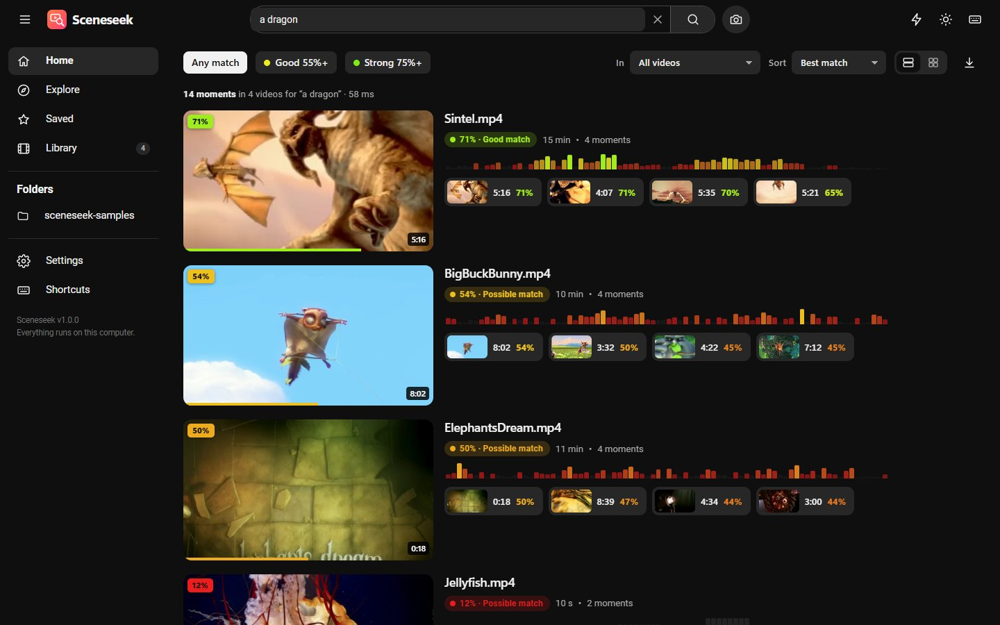
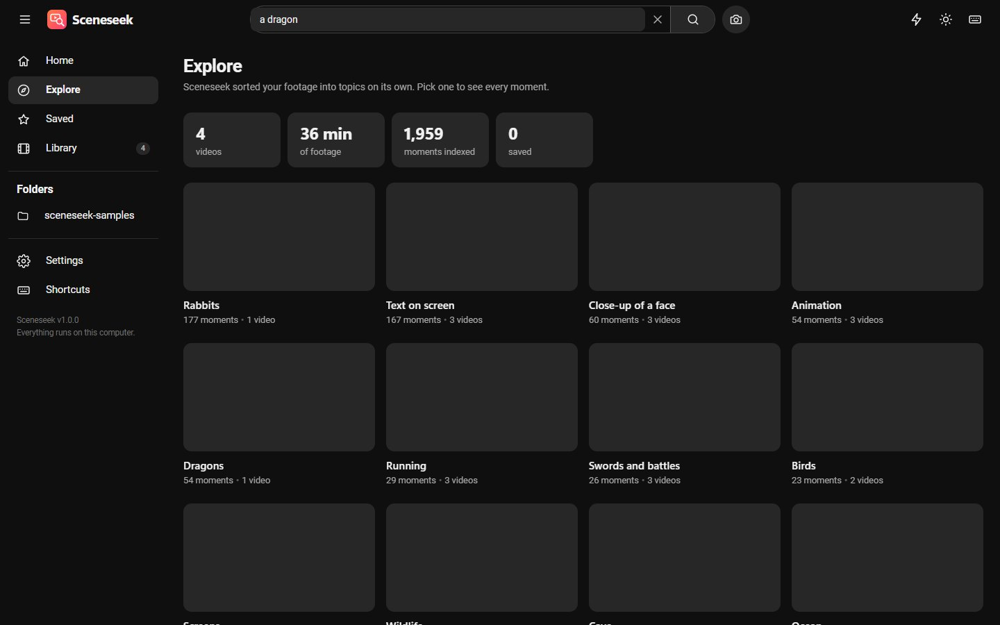
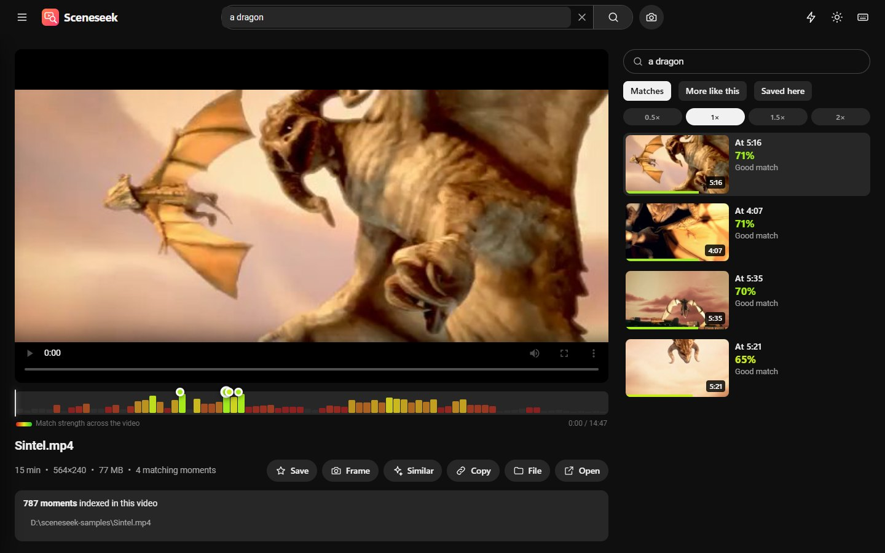

# Sceneseek

**Find any moment in your videos by describing it.** Type "a dragon over a castle" or "two people laughing at a table" and Sceneseek jumps to the exact second. It runs entirely on your computer: no account, no cloud, nothing is uploaded.



## What it does

- **Describe it, find it.** Search your own footage in plain English. Results read like a video site: a thumbnail per video, key-moment timestamps you can click, and every match percentage colour-coded from red (weak) to green (strong).
- **Power search.** `dog + snow` asks for both, `beach -night` leaves night shots out.
- **Explore.** Sceneseek sorts your footage into topics on its own (faces, beaches, cars, text on screen...) so you can browse without typing.
- **A watch page like a video site.** Opens at the match, with a coloured match heatmap, a scene strip, playback speed, keyboard control, search inside that one video, and an up-next list of matches, similar videos and saved moments.
- **Saved moments.** Star shots, add notes, export the list as CSV. Save any frame as a full-resolution picture.
- **Search by image.** Paste or drop a picture to find footage that looks like it, or click **Similar** on any moment.
- **Built for speed.** Hover previews, a command palette (`Ctrl K`), shortcuts for everything, light and dark themes.
- **Smart indexing.** Watched folders, repeated scenes skipped, pause and cancel, only changed files re-read.
- **Private by design.** The AI runs on your computer. Your videos are never copied or changed, and the app only answers to your own machine.




## Download

Get the latest Windows build from the [Releases page](https://github.com/galavixofficial/Video-Search-Engine/releases/latest), unzip it and run `Sceneseek.exe`. The first launch downloads the search model once (about 150 MB), then everything works offline.

Windows may show a SmartScreen notice because the app is new and not code-signed yet: choose **More info**, then **Run anyway**.

## Run from source

Requires Python 3.10 or newer.

```bash
uv sync            # or: pip install -r requirements.txt
uv run python main.py
```

`python main.py --browser` opens the app in your default browser instead of its own window, and `--no-window` just starts the server.

Run the tests with `uv run pytest`. Build the Windows app with `uv run pyinstaller sceneseek.spec --noconfirm`.

## How it works

1. **Indexing.** Each video is read about once per second (configurable). Frames that barely changed are skipped, the rest are embedded with CLIP ViT-B/16 running on ONNX Runtime (no PyTorch needed), and the vectors are stored in a local SQLite database.
2. **Searching.** Your description is embedded with the same model and compared with every stored frame. The best frames are grouped by video and merged into distinct moments.
3. **Playing.** The video is streamed from where it already lives on disk, starting a moment before the match.

The model files come from a public ONNX conversion of OpenAI's CLIP (MIT licence). "Fast" is the quantised model (about 150 MB), "Best" the full-precision one (about 600 MB).

## Good to know

- CLIP matches what things **look like**. It is good at scenes, objects, colours and actions; it does not understand speech and is weak at reading text on screen.
- Indexing speed depends on your processor. On our test PC it handled roughly eight sampled frames per second, so a 10 minute video took about a minute and a half with default settings.
- Formats the built-in player cannot show (some `.mkv`, `.avi`, `.wmv` files) can still be searched; use **Open** to play them in your usual player.
- Data lives in `%LOCALAPPDATA%\Sceneseek` (or `./data` when run from source).

## Project layout

```
main.py             launcher: starts the local server and opens the window
app/main.py         API (FastAPI) and security checks
app/clip.py         ONNX CLIP encoder and model download
app/indexer.py      background indexing
app/store.py        SQLite library, in-memory search, saved moments
app/explore.py      automatic topics for the Explore page
app/static/         the web UI (plain HTML, CSS and JavaScript)
tests/              pytest suite
website/            the download website
```

## Credits and licence

MIT licensed, see [LICENSE](LICENSE). Screenshots use footage from the Blender Foundation's open movies *Big Buck Bunny*, *Sintel* and *Elephants Dream* (CC BY 3.0) and a test clip from test-videos.co.uk.

Built by [Galavix](https://github.com/galavixofficial).
